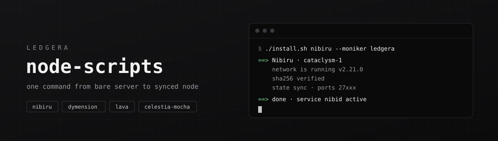

<p align="center">
  
</p>

<p align="center">
  Install scripts for the networks <a href="https://proledgera.com">Ledgera</a> operates on.<br/>
  Bare Ubuntu server → synced node under systemd, in one command.
</p>

---

```bash
git clone https://github.com/LedgeraLedgera/node-scripts && cd node-scripts
bash install.sh celestia-mocha --moniker my-node
```

The installer asks the network which version it is running right now, downloads that official release binary, checks its sha256, writes the config and starts the node with state sync. No compiling and no Go toolchain, and nothing is hard-coded to a version that has since gone stale.

## Networks

| network | chain id | binary | port prefix | type |
|---|---|---|---|---|
| `nibiru` | `cataclysm-1` | `nibid` | `27` | mainnet |
| `dymension` | `dymension_1100-1` | `dymd` | `28` | mainnet |
| `lava` | `lava-mainnet-1` | `lavad` | `29` | mainnet |
| `celestia-mocha` | `mocha-5` | `celestia-appd` | `26` | testnet · consensus node |

Each network gets its own port prefix, so all four can run side by side on one machine: p2p `NN656`, rpc `NN657`, grpc `NN090`, api `NN317`.

## What `install.sh` does

1. **Preflight** — checks CPU, RAM, disk and architecture (amd64 / arm64), and makes sure the ports and home directory are free.
2. **Version** — reads `/abci_info` from a public RPC to get the version the chain runs now. `--version` overrides it.
3. **Binary** — downloads the release asset from the project's GitHub, checks it against the published checksum file and installs it to `/usr/local/bin`.
4. **Config** — sets the genesis (and checks its chain id), seeds, peers, minimum gas price, custom pruning `100/19` and the Prometheus endpoint, and moves all ports to the network's prefix.
5. **Sync** — sets up state sync against two public RPCs, trusting a block about 2,000 heights back. `--snapshot <url>` restores a snapshot instead.
6. **Service** — writes a systemd unit, enables it and starts it. It also records the install in `/etc/ledgera-node/<network>.conf` for the tools below.

## Options

```text
--moniker <name>     node name (required)
--port-prefix <NN>   26656 -> NN656 (default: per network, table above)
--home <dir>         node home (default: ~/.nibid, ~/.dymension, ~/.lava, ~/.celestia-app)
--version <tag>      install a specific release instead of the live one
--snapshot <url>     restore a .tar.lz4 / .tar.zst / .tar.gz snapshot instead of state sync
--no-statesync       sync from genesis
--keep-indexer       keep the tx indexer on (off by default, validators do not need it)
--strict             refuse a release that has no checksum file
-y, --yes            no confirmation prompt
```

## Tools

```bash
bash tools/status.sh   <network>               # service, sync, height vs network, peers, version drift
bash tools/upgrade.sh  <network> [tag]         # swap the binary for the live (or given) release, restart
bash tools/upgrade.sh  <network> --rollback    # put the previous binary back
bash tools/remove.sh   <network> [--purge]     # remove service + binary; --purge backs up keys, then deletes data
```

`status.sh` warns when your binary differs from what the network runs, which is usually the first sign of an upcoming upgrade.

## Fibre (Celestia validators)

[Fibre](https://github.com/celestiaorg/celestia-app/tree/main/fibre) is Celestia's data availability server, run by validators from app version 10. `fibre.sh` installs it next to a `celestia-mocha` node set up by `install.sh`:

```bash
bash fibre.sh install            # --port 7980, --home <dir> on a separate disk recommended
bash fibre.sh status             # service, version vs node, port, on-chain registration
bash fibre.sh upgrade            # match fibre to the node's version after a node upgrade
bash fibre.sh remove [--purge]
```

Before it touches anything, `install` checks that the node is synced, on app version 10 or later, has app gRPC enabled and is bonded (it warns if it is not). It enables the node's privval gRPC endpoint (`127.0.0.1:26669`) if needed, downloads the `fibre` binary from the same release as the node and verifies its checksum. Then it starts fibre under systemd, wired to the node's gRPC and signer.

Registering the host on-chain signs a transaction with your validator key, so the script does not do it for you. It prints the exact `tx valaddr set-host` command for you to run once port `7980` is open. Fibre's defaults assume a 32 GB host; see the [operator guide](https://github.com/celestiaorg/celestia-app/blob/main/fibre/cmd/README.md) for tuning and remote-signer setups.

## Requirements

- Ubuntu 24.04 or Debian 12, amd64 or arm64. Celestia v10 builds need glibc ≥ 2.38, so Ubuntu 22.04 will not work for `celestia-mocha`.
- A user with `sudo`. The node runs as whoever runs the installer.
- Recommended minimums (the installer warns below these): Nibiru and Dymension 4 vCPU / 16 GB / 500 GB, Lava 4 vCPU / 8 GB / 300 GB, Celestia Mocha 8 vCPU / 24 GB / 500 GB.

## Layout

```text
install.sh              entry point
fibre.sh                Fibre server for Celestia validators
lib/common.sh           shared steps: checks, download + verify, config, state sync, systemd
networks/<name>.env     everything network-specific: chain id, repo, genesis, seeds, RPCs, asset names
tools/                  status · upgrade · remove
```

To add a network, add a `networks/<name>.env` with the same fields and an `asset_name` function for its release file naming. If the chain needs host changes, add a `prepare_host` hook too, like the BBR setup in `celestia-mocha.env`.

## Notes

- **Validators:** the scripts set up a full node. Create the validator from your wallet only after `status.sh` shows `synced`, and back up `config/priv_validator_key.json` first. Never run the same key on two machines.
- **Celestia:** the installer turns on BBR congestion control, which `celestia-app` requires. It installs the standalone build, which is enough for a node joining at the current app version. Fibre is covered by `fibre.sh`; bridge and light nodes are out of scope.
- **Not covered:** Starknet and Ethereum run on different client stacks and are not part of these scripts.
- **State sync** depends on public RPCs serving snapshots. If it stalls, reinstall with `--snapshot <url>` from a provider you trust.

---

<p align="center">
  <a href="https://proledgera.com">proledgera.com</a> ·
  <a href="https://proledgera.com/transparency/">transparency</a> ·
  <a href="https://github.com/LedgeraLedgera">github</a>
</p>
